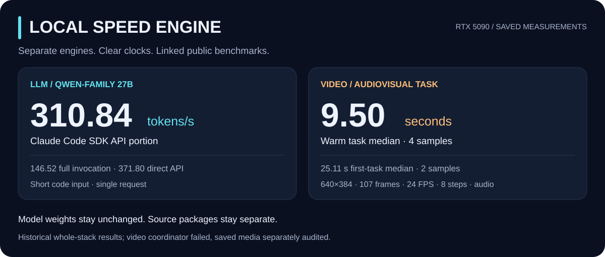

<div align="center">

# Local Speed Engine

### Local models. Measured speed.

[**LLM engine →**](https://github.com/memoriesdead/local-llm-engine) · [**Video →**](https://github.com/memoriesdead/video) · [LLM benchmarks](https://github.com/memoriesdead/local-llm-engine/blob/main/benchmarks/comparison.md) · [Video benchmarks](https://github.com/memoriesdead/video/blob/main/benchmarks/comparison.md)



</div>

Run compatible models locally, keep stored weight files unchanged, and measure the
time that matters to your application. This repository is the benchmark hub;
the LLM and video packages have **separate repositories, setup guides and releases**.

| Project | Our saved result · one RTX 5090 | Get the source | Complete comparison |
| --- | --- | --- | --- |
| **Local LLM Engine** | **310.84 tokens/s** · Claude Code SDK API portion | [LLM repository](https://github.com/memoriesdead/local-llm-engine) | [24 detailed runtimes + 25 additional sources + 5 hosted providers](https://github.com/memoriesdead/local-llm-engine/blob/main/benchmarks/comparison.md) |
| **Video** | **9.50 s** · warm audiovisual task | [Video repository](https://github.com/memoriesdead/video) | [30 local project groups + 7 frontier providers](https://github.com/memoriesdead/video/blob/main/benchmarks/comparison.md) |

These are **historical whole-stack measurements**, not fresh GPU tests of the
public packages or measured gains attributable to their patches. Short-prompt
LLM speed is not full-context speed. Video used repeated warm conditioning.

## LLM · tokens per second

Our three timing boundaries stay separate:

| Measured boundary | Generated tokens/s | Workload |
| --- | ---: | --- |
| Claude Code SDK **API portion** | **310.84** | One short code request |
| **Complete** Claude Code invocation | **146.52** | Fresh client invocation, including its overhead |
| **Direct API** request wall time | **371.80** | One short code request, including API overhead |

Qwen-family 27B on one RTX 5090. Configured context: **98,304 tokens**;
a separate retrieval check used **90,000 actual input tokens**. These speed
measurements did not use that full context. [Reference data](https://github.com/memoriesdead/local-llm-engine/blob/main/benchmarks/reference.json).

### Selected published comparisons

Publisher figures below use different models, settings and clocks. Rows follow
source groups, not speed order; they are **not a matched leaderboard**.

| Source | Publisher's figure · tokens/s | Hardware / model | Timing and comparison limit |
| --- | ---: | --- | --- |
| [NInfer](https://github.com/Neroued/ninfer) | 147.7 | 1× RTX 5090 · Qwen3.8-27B NVFP4 | Single-request steady decode; 8,192 generated tokens; different clock |
| [NInfer-all](https://github.com/iamwavecut/ninfer-all/blob/master/docs/performance.md) | 233.5 | 1× RTX 5090 · Qwen3.8 groupwise-int | Short-chat decode, five 512-token answers; different recipe |
| [mkyt](https://github.com/mkyt/qwen3-27b-5090/blob/main/docs/benchmarks.md) | 386 code / 258 prose | 1× RTX 5090 at 400 W · Qwen3.8-27B | First-to-last-token decode; excludes first-token wait |
| [Ignis](https://github.com/gpillon/ignis) | 367 | 1× RTX 5090 · Qwen3.8-27B NVFP4 | Geometric mean across eight coding tasks; different metric |
| [Token Rush](https://github.com/zyhector/token-rush) | 358 code / 229 essay | 1× RTX 5090 · Qwen3.8-27B GPTQ | Batch-one short-context decode; different weight representation |
| [Cerebras](https://inference-docs.cerebras.ai/models/overview) | ~1,850 | Provider hardware · Qwen3.8-27B | Catalog figure; hardware count and matching request conditions unknown |
| [Groq](https://console.groq.com/docs/models) | 450 | Provider hardware · Qwen3.8-27B preview | Catalog figure; matching request conditions unknown |

[OpenAI](https://developers.openai.com/api/docs/models),
[Anthropic](https://platform.claude.com/docs/en/models/overview) and
[Google](https://ai.google.dev/gemini-api/docs/models) are included in the
[frontier comparison](https://github.com/memoriesdead/local-llm-engine/blob/main/benchmarks/comparison.md#hosted-providers-and-frontier-models).
Their reviewed model overviews supplied no matched output-speed result.
Model quality and coding ability were not benchmarked here.

[**Full LLM table, conditions and official links →**](https://github.com/memoriesdead/local-llm-engine/blob/main/benchmarks/comparison.md)
 · [JSON data](https://github.com/memoriesdead/local-llm-engine/blob/main/benchmarks/comparison.json)
 · [Timing protocol](https://github.com/memoriesdead/local-llm-engine/blob/main/benchmarks/protocol.md)

## Video · seconds per finished task

| Our measured task | Median | Samples | Output |
| --- | ---: | ---: | --- |
| **Warm task** | **9.50 s** | 4 | 640×384 · 107 frames · 24 FPS · 8 steps · audio |
| **First task** | **25.11 s** | 2 | Same output settings; task can include loading and shape preparation |

Task clocks include processing and saving; process startup is separate. The full
coordinator **failed** its process-identity guard before final exit. Twelve saved
audiovisual outputs passed a separate full-decode and same-profile repeatability
audit. The overall run remains failed, and output quality equivalence is unproven.
[Samples and limits](https://github.com/memoriesdead/video/blob/main/benchmarks/reference.json).

### Selected published comparisons

Different model, resolution, step count, audio or GPU count means a different job.
External figures are publisher reports, not runs performed here.

| Source | Publisher's time | Hardware | Workload / comparison limit |
| --- | ---: | --- | --- |
| [FastVideo / FastWan-QAD](https://haoailab.com/blogs/fastwan-qad/) | 1.8 s | 1× RTX 5090 | 480p, 5 s requested, distilled 1.3B, 3 steps, tiny decoder; audio/startup timing not reported |
| [LightX2V / LightWan2.2-A14B](https://huggingface.co/lightx2v/LightWan2.2-A14B/blob/a6f09bcd5ffbd079e7397cb7c185691a13445af7/README.md) | 14.15 s | 1× RTX 5090 | 480p, 4-step NVFP4/sparse recipe; frames, audio and warm state not reported |
| [FastVideo / FastH3 Omni](https://haoailab.com/blogs/fastvideo-omniref-update/) | 5.67 s mean | **8× GB200** | 768p, 124 frames, 8 steps, audio; completed-MP4 client clock, startup excluded |
| [NVIDIA Sol / H3](https://nvlabs.github.io/Sana/Sol-Engine/H3-OnDevice/) | 231.2 s | 1× RTX 5090 | 768p, 124 frames, **50 steps**, audio; warm publisher E2E clock |

Veo, Sora, Runway, Luma, Kling, Pika and MiniMax/Hailuo have a separate
[frontier service table](https://github.com/memoriesdead/video/blob/main/benchmarks/comparison.md#frontier-services),
including current availability notices and unknown timing fields. Clip duration,
streaming FPS and first-frame latency are separate from finished-video time.

[**Full video table, conditions and official links →**](https://github.com/memoriesdead/video/blob/main/benchmarks/comparison.md)
 · [JSON data](https://github.com/memoriesdead/video/blob/main/benchmarks/comparison.json)
 · [Timing protocol](https://github.com/memoriesdead/video/blob/main/benchmarks/protocol.md)

## Source coverage

Official sources checked **2026-10-30**. The catalogs cover the projects below;
they do not claim every fork was tested. Apps, models, kernels and recipes are
labeled separately because they are not interchangeable complete engines.
“Not measured here” means no matched benchmark was run for this comparison.

<details>
<summary><strong>LLM: 24 detailed runtime/source projects</strong></summary>

| Project / official source | What it is | Comparison entry |
| --- | --- | --- |
| [vLLM](https://docs.vllm.ai/en/latest/) | General serving runtime | Not measured here |
| [SGLang](https://github.com/sgl-project/sglang) | Language-model and multimodal serving | Not measured here |
| [TensorRT-LLM](https://github.com/NVIDIA/TensorRT-LLM) | NVIDIA inference runtimes and kernels | Not measured here |
| [llama.cpp](https://github.com/ggml-org/llama.cpp) | C/C++ inference across hardware backends | Not measured here |
| [NInfer upstream](https://github.com/Neroued/ninfer) | Specialized C++/CUDA engine | 147.7 single decode; 922.4 at eight requests |
| [NInfer-all / WaveCut fork](https://github.com/iamwavecut/ninfer-all/blob/master/docs/performance.md) | C++/CUDA fork used as this package's base | 233.5 short-chat decode |
| [ExLlamaV3](https://github.com/turboderp-org/exllamav3) | EXL3 quantized consumer-GPU inference | Not measured here |
| [LMDeploy](https://github.com/InternLM/lmdeploy) | Compression, deployment and serving toolkit | Not measured here |
| [MLC-LLM](https://github.com/mlc-ai/mlc-llm) | Compiled deployment engine | Not measured here |
| [MLX-LM](https://github.com/ml-explore/mlx-lm) | Apple-silicon inference with MLX | Not measured here |
| [FastDeploy](https://github.com/PaddlePaddle/FastDeploy) | PaddlePaddle-based LLM/VLM deployment | Not measured here |
| [Chitu](https://github.com/thu-pacman/chitu) | Language-model inference framework | Not measured here |
| [Text Generation Inference (TGI)](https://github.com/huggingface/text-generation-inference) | Text-generation server; repository says maintenance mode | Not measured here |
| [LightLLM](https://github.com/ModelTC/LightLLM) | Python inference and serving framework | Not measured here |
| [KTransformers](https://github.com/kvcache-ai/ktransformers) | Heterogeneous inference framework | Not measured here |
| [PowerInfer](https://github.com/Tiiny-AI/PowerInfer) | Local model serving | Not measured here |
| [Aphrodite / Sonar](https://github.com/dphnAI/sonar) | Serving engine; former Aphrodite URL redirects here | Not measured here |
| [nano-vLLM](https://github.com/GeeeekExplorer/nano-vllm) | Small inference-engine implementation | 1,434.13 aggregate |
| [mistral.rs](https://github.com/EricLBuehler/mistral.rs) | Rust inference runtime | Not measured here |
| [DeepSpeed-MII](https://github.com/deepspeedai/DeepSpeed-MII) | DeepSpeed-backed inference serving | Not measured here |
| [ExLlamaV2](https://github.com/turboderp-org/exllamav2) | Consumer-GPU inference library | Not measured here |
| [mkyt single-GPU engine](https://github.com/mkyt/qwen3-27b-5090/blob/main/docs/benchmarks.md) | Specialized Qwen3.8-27B C++/CUDA engine | 386 code / 258 prose decode |
| [Ignis](https://github.com/gpillon/ignis) | Rust/CUDA single-GPU engine | 367 coding geometric mean |
| [Token Rush](https://github.com/zyhector/token-rush) | Specialized single-stream engine | 358 code / 229 essay decode |

</details>

<details>
<summary><strong>LLM: 25 additional forks, recipes, methods and components</strong></summary>

These are public source links, not 25 additional independently measured engines.

| Source | Type | Result |
| --- | --- | --- |
| [zhongkaifu/TensorSharp](https://github.com/zhongkaifu/TensorSharp) | Specialized runtime/source project | Not measured here |
| [wamansou/ninfer-tp2-1m](https://github.com/wamansou/ninfer-tp2-1m) | Specialized runtime/source project | Not measured here |
| [kacper-daftcode/qwentin](https://github.com/kacper-daftcode/qwentin) | Specialized runtime/source project | Not measured here |
| [kekzl/imp](https://github.com/kekzl/imp) | Specialized runtime/source project | Not measured here |
| [flashinfer-ai/flashinfer](https://github.com/flashinfer-ai/flashinfer) | Kernel library | Not measured here |
| [z-lab/dflash](https://github.com/z-lab/dflash) | Speculative-decoding method | Not measured here |
| [SafeAILab/EAGLE](https://github.com/SafeAILab/EAGLE) | Speculative-decoding method | Not measured here |
| [FasterDecoding/Medusa](https://github.com/FasterDecoding/Medusa) | Speculative-decoding method | Not measured here |
| [hao-ai-lab/LookaheadDecoding](https://github.com/hao-ai-lab/LookaheadDecoding) | Speculative-decoding method | Not measured here |
| [mit-han-lab/Quest](https://github.com/mit-han-lab/Quest) | Long-context component/method | Not measured here |
| [LukasParke/qwen38-27b-5090](https://github.com/LukasParke/qwen38-27b-5090) | Recipe/setup project | Not measured here |
| [thomgardiner/sglang-sm120-nvfp4](https://github.com/thomgardiner/sglang-sm120-nvfp4) | Backend patch | Not measured here |
| [flashrt-project/FlashRT](https://github.com/flashrt-project/FlashRT) | Specialized runtime/source project | Not measured here |
| [Wallawalla47/Infernix](https://github.com/Wallawalla47/Infernix) | Specialized runtime/source project | Not measured here |
| [Ryan-gsq/ninfer-16g-5070ti-5080-5090-qwen3.8-27b-gsq-rco](https://github.com/Ryan-gsq/ninfer-16g-5070ti-5080-5090-qwen3.8-27b-gsq-rco) | Backend fork | Not measured here |
| [adrienbrault/qwen3.8-27b-rtx5090](https://github.com/adrienbrault/qwen3.8-27b-rtx5090) | Multiple-GPU recipe | Not measured here |
| [splickz/ninfer-yarn-nvfp4](https://github.com/splickz/ninfer-yarn-nvfp4) | Long-context recipe | Not measured here |
| [varjoranta/turboquant-vllm](https://github.com/varjoranta/turboquant-vllm) | Long-context component/method | Not measured here |
| [BigBIueWhale/qwen_38_agent_setup](https://github.com/BigBIueWhale/qwen_38_agent_setup) | Long-context recipe | Not measured here |
| [tsarihan/qwen3.8-27b-rtx5090-playbook](https://github.com/tsarihan/qwen3.8-27b-rtx5090-playbook) | Recipe/setup project | Not measured here |
| [alphastorm/ninfer](https://github.com/alphastorm/ninfer) | Backend fork | Not measured here |
| [kurmetov/qwencore](https://github.com/kurmetov/qwencore) | Specialized runtime/source project | Not measured here |
| [r0b0tlab/qwen38-exl3-dflash2](https://github.com/r0b0tlab/qwen38-exl3-dflash2) | Recipe/setup project | Not measured here |
| [NVIDIA/TensorRT-Edge-LLM](https://github.com/NVIDIA/TensorRT-Edge-LLM) | Edge inference project | Not measured here |
| [Intelligent-Internet/Qwen3.8-Inference-MetaZenith](https://github.com/Intelligent-Internet/Qwen3.8-Inference-MetaZenith) | Backend patch | Not measured here |

</details>

<details>
<summary><strong>LLM: four apps and frontends</strong></summary>

| Project | Scope | Result |
| --- | --- | --- |
| [Ollama](https://docs.ollama.com/) | Application, model management and API; local and cloud routes exist. | Not measured here |
| [LM Studio](https://lmstudio.ai/docs/app/offline) | Desktop app/local server; downloads and selects separately packaged runtimes. | Not measured here |
| [Jan](https://github.com/janhq/jan) | Desktop model application; backend/model choice determines generation speed. | Not measured here |
| [Open WebUI](https://github.com/open-webui/open-webui) | Interface to inference backends; not a separate decode-kernel benchmark. | Not measured here |

</details>

<details>
<summary><strong>Video: 30 runtimes, models and components</strong></summary>

| Project / official source | Type | Scope |
| --- | --- | --- |
| [WanGP](https://github.com/deepbeepmeep/WanGP) | runtime | Multi-model runtime and this package's upstream base. Our historical speed is one development-stack result. |
| [ComfyUI](https://github.com/Comfy-Org/ComfyUI) | workflow_runtime | Node-based runtime. Model, nodes, kernels and workflow determine speed; no matched 107-frame H3 audiovisual wall clock was extracted from the reviewed overview. |
| [Diffusers](https://huggingface.co/docs/diffusers/main/en/optimization/fp16) | pipeline_library | Video pipelines with compilation, attention, offload and precision options. A library name alone does not fix the workload or timing boundary. |
| [FastVideo](https://github.com/hao-ai-lab/FastVideo) | runtime_and_post_training | Runtime and post-training framework; the two reported recipes below differ. |
| [LightX2V](https://github.com/ModelTC/LightX2V) | runtime_and_post_training | Four-step distilled NVFP4/sparse Wan2.2; see reported times below. |
| [TurboDiffusion](https://github.com/thu-ml/TurboDiffusion) | runtime_and_distilled_models | Distilled/quantized Wan recipe; reported settings and timings differ between sources. |
| [xDiT / xFuser](https://github.com/xdit-project/xDiT) | distributed_runtime | Hybrid sequence/CFG/pipeline parallelism and caching. The linked CogVideo report uses 1-12 L40 GPUs; it is not a single-5090 result. |
| [StreamDiffusionV2](https://github.com/chenfengxu714/StreamDiffusionV2) | streaming_runtime | Interactive video-to-video streaming; report separates first-frame latency and sustained FPS. Neither is the elapsed time to save a finished audiovisual file. |
| [StreamDiffusion](https://github.com/cumulo-autumn/StreamDiffusion) | image_streaming_pipeline | Original pipeline accelerates repeated image generation/stream transformation. Image FPS must not be counted as native temporal-video or finished-file latency. |
| [SGLang Diffusion](https://github.com/sgl-project/sglang) | serving_runtime | Built-in image/video engine with a current H3 cookbook. Model-specific device and attention support needs checking; no matched local task was run here. |
| [vLLM-Omni](https://github.com/vllm-project/vllm-omni) | serving_runtime | Supports diffusion stages, request batching and joint H3 video/audio serving. A supported model entry is not a latency benchmark. |
| [TensorRT-LLM VisualGen](https://github.com/NVIDIA/TensorRT-LLM/blob/main/docs/source/models/visual-generation.md) | serving_runtime | Visual-generation subsystem. H3 TRTLLM attention is currently restricted to SM100/SM103; that restriction is H3-specific, not universal to VisualGen. |
| [NVIDIA Sol Video Inference Engine](https://nvlabs.github.io/Sana/Sol-Engine/H3-OnDevice/) | runtime_recipe | H3 kernel, sparse-attention and residual-cache recipe; 50-step 768p workload differs from ours. |
| [stable-diffusion.cpp](https://github.com/leejet/stable-diffusion.cpp) | cpp_runtime | C/C++ diffusion runtime with local video support. Different model formats, kernels and loading paths need their own matched test. |
| [DiffSynth-Studio](https://github.com/modelscope/DiffSynth-Studio) | runtime_and_training_library | Video inference/training library, including H3 video/audio and low-memory paths. No matched wall-clock row was extracted from the reviewed overview. |
| [Cache-DiT](https://github.com/vipshop/cache-dit) | optimization_integration_library | PyTorch/Diffusers integration for caching, parallelism, quantization and offload. Model-specific settings and approximation policy matter. |
| [LTX-Video](https://github.com/Lightricks/LTX-Video) | model_and_reference_implementation | Earlier LTX model family and inference code. Its paper's two-second H100 result is separate from current LTX-2 releases. |
| [LTX-2 family](https://github.com/Lightricks/LTX-2) | model_and_reference_implementation | Current official repository quickstart uses LTX-2.5 and joint audio/video pipelines. Distilled and production-detailing paths have different cost. |
| [FramePack](https://github.com/lllyasviel/FramePack) | model_method_and_reference_implementation | Next-frame-section generation with bounded context. Author reports seconds per generated frame; TeaCache can change the output. |
| [Wan2.2](https://github.com/Wan-Video/Wan2.2) | model_and_reference_implementation | Includes 5B hybrid TI2V and larger MoE models. Native TI2V speed statement is a different model, resolution and schedule from H3. |
| [HunyuanVideo-1.5](https://github.com/Tencent-Hunyuan/HunyuanVideo-1.5) | model_and_reference_implementation | Official 480p step-distilled I2V release reports a 4090 upper-bound time; the benchmark statement does not pin all settings. |
| [CogVideo / CogVideoX](https://github.com/zai-org/CogVideo) | model_and_reference_implementation | Official model table separates versions, precision, resolution, hardware and offload. No matched H3 audiovisual speed was measured here. |
| [Mochi 1](https://github.com/genmoai/mochi) | model_and_reference_implementation | Genmo model and reference inference code; consumer-GPU integrations exist. The overview is not a comparable full-file benchmark. |
| [Open-Sora](https://github.com/hpcaitech/Open-Sora) | model_and_training_inference_stack | HPC-AI implementation, including Open-Sora 2.0. This is distinct from OpenAI Sora; no matched local video latency was extracted. |
| [NVIDIA Cosmos](https://github.com/NVIDIA/Cosmos) | world_models_and_reference_stack | Cosmos 3 is current; Predict2.5 is in limited maintenance. Physical-world prediction and audiovisual generation have different tasks and hardware tiers. |
| [MiniMax H3](https://github.com/MiniMax-AI/MiniMax-H3) | model_and_reference_implementation | Open multimodal model with native stereo audio and several task modes. The model is distinct from WanGP and its optimized/distilled derivatives. |
| [Video DeltaNet / VDN-H3](https://github.com/OpenVDN/vdn-minimax-h3) | modified_model_and_inference_recipe | Hybrid-attention H3 derivative using an added linear branch/adapters. Published eight-B200 speed is not an unchanged-model comparison. |
| [TeaCache](https://github.com/ali-vilab/TeaCache) | cache_component | Cross-timestep reuse component, integrated into several runtimes. It can change output; it is not a standalone video engine or a weight-only speed claim. |
| [SageAttention](https://github.com/thu-ml/SageAttention) | attention_component | Quantized attention kernels, including separate Blackwell code. Attention-kernel speedups do not directly establish finished-video latency or exact output identity. |
| [FlashAttention](https://github.com/Dao-AILab/flash-attention) | attention_component | Memory-efficient attention library; current README includes FlashAttention-4. Its kernel throughput is a component result, not an audiovisual-engine benchmark. |

</details>

## Use the separate engines

- [**Local LLM Engine**](https://github.com/memoriesdead/local-llm-engine): pinned NInfer and experimental llama.cpp source patches, setup and numerical checks.
- [**Video**](https://github.com/memoriesdead/video): pinned WanGP integration, caching, guarded graph reuse and finite local batches.

Model support comes from the selected backend. These packages preserve stored
model weight files; they do not make every model compatible or guarantee identical
output across recipes. No model weights, prompts, private media or credentials
are distributed. Inference stays local with no hosted fallback.

**Still unachieved:** 1,000 single-request generated tokens/s, a qualified
million-token coding context, and one-second fresh complete audiovisual generation.

<details>
<summary>Original shared source toolkit and licenses</summary>

The original combined patch toolkit remains in this repository. Use the separate
projects above for focused setup and benchmark documentation.

```shell
python tools/engine.py list
python tools/check_release.py --check
```

- [NInfer source patch](backends/ninfer/README.md)
- [llama.cpp experimental CPU patch](backends/llama-cpp/README.md)
- [WanGP local video integration](backends/wangp/README.md)
- [Original source snapshot](https://github.com/memoriesdead/local-speed-engine/releases/tag/v0.1.0)
- [Original aggregate measurements](benchmarks/reference.json)

Original top-level tools use [Apache-2.0](LICENSE). Backend-derived code retains
its [backend-specific licenses](LICENSES.md), including WanGP Community License
2.0 and its commercial-use terms. Read [the notices](THIRD_PARTY_NOTICES.md).

</details>
